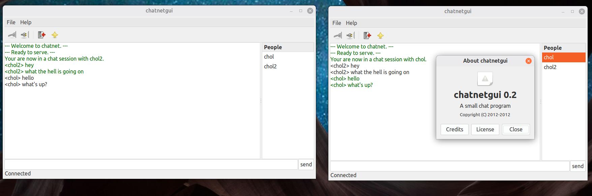

# Chatnet

Chatnet is a small, IRC-inspired, multi-user chat application written in C++.
It consists of a threaded TCP server and a GTK desktop client. Many users can
connect to the server at once, while each client participates in one private
chat session at a time.



*Chatnet server and GTK client running on Linux Mint 17 (2026).*

## Background

Chatnet began in 2012 as a socket-programming exercise. The first version had
a command-line client and server; the graphical client was added to explore
GTKmm, POSIX threads, and keeping network work from blocking the GTK event
loop. The original design notes are preserved in
[`docs/pseudo_code`](docs/pseudo_code).

## How it works

- The server listens for TCP connections on port `7999` and starts a POSIX
  thread for each connected client.
- On connection, the server validates the chosen nickname. Nicknames must be
  unique, 3–16 characters long, and contain only letters and digits.
- The GTK client receives connection events in a background thread and keeps
  its visible user list in sync as people join or leave.
- Starting a chat checks that the selected user is online and not already in
  another chat. Messages are then relayed privately through the server.
- The client displays server messages and errors in a scrolling log and
  provides menu and toolbar actions for connecting and disconnecting.

## Requirements

Chatnet is a legacy Linux application and uses:

- a C++ compiler and `make`
- Autoconf, Automake, and `pkg-config`
- POSIX sockets and threads
- GTKmm 2.4 development files (`gtkmm-2.4` via `pkg-config`)

GTKmm 2.4 is obsolete and may not be available in current distribution
repositories. A compatible legacy system or container may therefore be the
easiest environment in which to build the GUI.

## Build

Generate the configuration script after cloning the repository (release
archives may already include it):

```sh
autoreconf --install
```

Configure and build both the server and graphical client from the repository
root:

```sh
./configure
make
```

`configure` checks for a working C++ compiler, POSIX networking headers,
POSIX threads, `pkg-config`, and GTKmm 2.4 before generating the unified root
Makefile. The resulting executables are `chatnets` and `chatnetgui` in the
repository root.

To remove compiled files, run `make clean`. To remove those files and all
generated configuration output, run `make distclean`.

Install both programs, the desktop launcher, icons, and documentation with:

```sh
sudo make install
```

Installation refreshes both the `hicolor` icon cache and desktop application
database automatically. These are freedesktop.org conventions supported by
major Linux desktop environments; the launcher is not tied to a particular
distribution or desktop. If an existing session cached an older installation,
use that desktop's application-menu refresh mechanism or sign out and back in.

The default installation prefix is `/usr/local`; select another prefix while
configuring, for example `./configure --prefix="$HOME/.local"`. Use
`make uninstall` to remove files installed by this build.

## Run

After `make install`, start the server first:

```sh
chatnets
```

The server forks into the background and listens on port `7999`. Don't panic if there was no output. It's running! and you can verify with netcat.

Then start one or more clients (or start from desktop menu/launcher):

```sh
chatnetgui
```

These commands work without a `./` prefix because `make install` places the
executables in the configured binary directory (`/usr/local/bin` by default),
which is normally included in the user's `PATH`. If you selected a custom
prefix, ensure its `bin` directory is in `PATH`.

To run directly from the source tree without installing, use `./chatnets` and
`./chatnetgui` from the repository root.

In each client, choose **File → Connect** (or the Connect toolbar button), then
enter:

- a unique nickname;
- the server hostname or IP address (`localhost` when running locally); and
- port `7999`.

Select a user from the user list to begin a private chat, or enter commands in
the message field.

## Client commands

| Command | Description |
| --- | --- |
| `/chat <name>` | Start a private chat with a connected user. |
| `/endchat` | End the current chat session. |
| `/list` | Display the connected users. |
| `/clear` | Clear the client's message log. |
| `/help` | Display the command summary in the client. |
| `/exit` | Disconnect from the server. |

While a chat is active, text that does not begin with `/` is sent to the other
participant. The protocol also supports `/msg <name> :<message>` internally,
but the GUI normally constructs this command automatically.

## Repository layout

```text
configure.ac               Autoconf dependency and platform checks
Makefile.am                Unified server/client build and install rules
server/                    Threaded TCP server
client/chatnetgui/src/     GTKmm client source
client/chatnetgui/icons/   Application icons
client/chatnetgui/desktop/ Desktop launcher
docs/pseudo_code           Original design notes and protocol sketch
docs/chatnet-2026.png      Application screenshot
```

## Project status

This repository is primarily a historical learning project. The code and
build system reflect the Linux/C++ ecosystem in which it was originally
written, including GTKmm 2.4 and direct POSIX socket/thread APIs.
